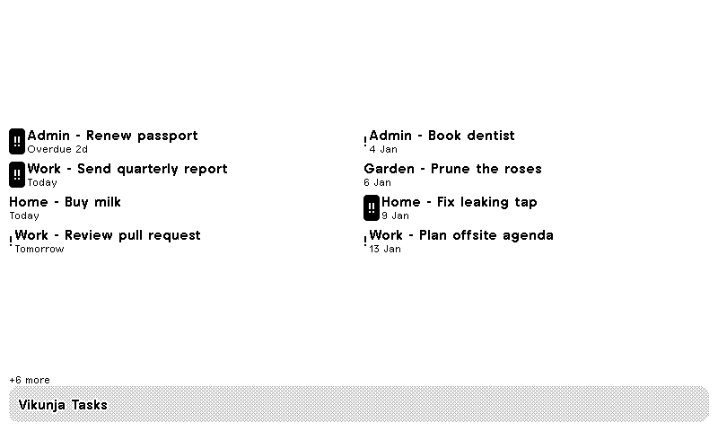
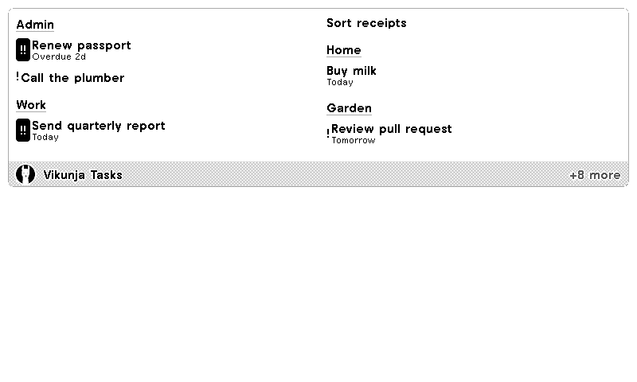
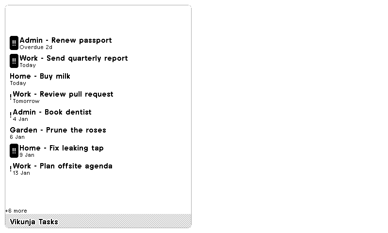
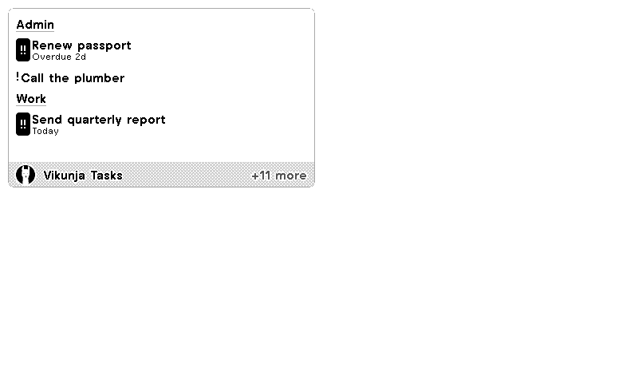

# Vikunja Tasks for TRMNL: user guide

This Recipe shows your open [Vikunja](https://vikunja.io) Tasks on your TRMNL. You set it up entirely inside TRMNL and Vikunja; you don't need to run anything yourself.

## Requirements

Vikunja **2.4.0 or newer**: the Recipe reads the [Vikunja API v2](https://try.vikunja.io/api/v2/docs), which 2.4.0 introduced. Vikunja Cloud is always current.

## Install

1. Download `trmnl-vikunja-<version>.zip` from the [latest release](https://github.com/allan-t/trmnl-vikunja/releases/latest). Don't unzip it.
2. In TRMNL, go to **Plugins > Private Plugin**, add a new plugin and choose to import a Recipe from a zip file.
3. Add the plugin to a playlist so it shows on your device.

(A listing in TRMNL's Recipes directory is planned; this guide will then point there instead.)

## Connect to Vikunja

1. In Vikunja, open **Settings > API Tokens** and create a token with **read** access to **Tasks** and **Projects**.
2. In the plugin's settings in TRMNL, paste it into **Vikunja API token**.
3. **Vikunja base URL**: leave it blank if you use Vikunja Cloud (`https://app.vikunja.cloud`). If you self-host, enter your instance address, for example `https://vikunja.example.com`. A trailing slash is fine.
4. Save, then refresh the plugin preview.

## Settings

The form groups the filter settings under **Filter options** and Group by Project under **Display options**.

| Setting | What it does |
| --- | --- |
| Vikunja base URL | Where your Vikunja lives. Blank means Vikunja Cloud. |
| Vikunja API token | Lets the Recipe read your Tasks and Projects. |
| Filter mode | **Standard** (default) uses the Projects and Priority settings below and shows open Tasks. **Custom filter** uses only the filter you write in **Custom filter**. |
| Custom filter | Custom filter mode only (hidden in Standard mode). For example `done = false && priority >= 3`. See [Vikunja's filter syntax](https://vikunja.io/docs/filters). Your filter is the only thing that picks Tasks: nothing like "not done" is added, so include `done = false` if you want open Tasks only. **Projects to show** and **Priority levels to show** are ignored. |
| Projects to show | Standard mode only (hidden in Custom filter mode). Type Project names separated by commas, for example `Home, Work`. Only Tasks from those Projects appear. Names aren't case sensitive. Leave empty to show every Project. A name that matches no Project is ignored. |
| Priority levels to show | Standard mode only (hidden in Custom filter mode). Pick the Priorities to show (Unset, Low, Medium, High, Urgent, Do now). Hold <kbd>Ctrl</kbd> or <kbd>⌘</kbd> and click to pick several. Leave empty to show all. |
| Group by Project | On: Tasks sit under a header for each Project. Off: one list of `Project - Task` rows. |

## What you'll see

Open Tasks are sorted by due date, then by Priority. Tasks without a due date come last. Each row can show a Priority icon (`!` for Medium and High, `!!` for Urgent and Do now) and a due label such as *Today*, *Tomorrow*, *Overdue 2d* or a date.

The Recipe fills the space your layout has. Tasks that don't fit are left out, and the title bar says how many (for example *+7 more*). Bigger layouts show more Tasks.

| Full | Half horizontal |
| --- | --- |
|  |  |
| **Half vertical** | **Quadrant** |
|  |  |

## Custom filter mode

Switch **Filter mode** to **Custom filter** and type a filter such as `done = false && (priority >= 3 || due_date < now+7d)`. Tasks are still sorted by due date, then Priority, and **Group by Project** still works. The filter's syntax is explained in the [Vikunja filter documentation](https://vikunja.io/docs/filters).

## Limits

- The Recipe reads up to **50 open Tasks** per refresh, picked after your Priority filter. Your Vikunja instance silently caps this at its own maximum page size, so a self-hosted instance configured below 50 shows fewer. Projects are filtered after that, so if you have many open Tasks in Projects you've hidden, some Tasks in the Projects you show may not appear.
- In Custom filter mode the same cap applies: the Recipe reads the first 50 Tasks your filter matches, in the sort order above.
- The screen refreshes every 15 minutes.

## Troubleshooting

- **"Could not load tasks"**: the Base URL or API token is wrong, the token lacks read access to Tasks and Projects, or Vikunja can't be reached from the internet. Check the URL opens in a browser and create a fresh token.
- **"Could not load tasks. Check the custom filter syntax."**: Vikunja rejected your filter in Custom filter mode. Check it against [Vikunja's filter syntax](https://vikunja.io/docs/filters). TRMNL gives the Recipe the error Vikunja sent back but not the HTTP status, so the Recipe recognises a rejected filter by Vikunja's filter error codes (4016-4019, 4024 and 4033). If your filter is fine and you still see the message above about the URL and API token, the problem is the connection or token.
- **"Custom filter mode is on but no filter is set. Enter a Vikunja filter in the settings."**: **Filter mode** is set to Custom filter but **Custom filter** is empty. The Recipe never falls back to showing all Tasks; enter a filter, or switch **Filter mode** back to Standard.
- **"No tasks match the custom filter"**: your filter is valid but matches no Tasks. Loosen it, or test it in Vikunja.
- **"No open tasks"**: you have none, or your filters leave nothing. Clear **Projects to show** and **Priority levels to show** to check.
- **"No open tasks in the selected Projects"**: none of the names in **Projects to show** match a Project with open Tasks. Check the spelling.
- **Self-hosting**: your Vikunja must be reachable from TRMNL's servers, not only your home network.

Found a problem? [Open an issue](https://github.com/allan-t/trmnl-vikunja/issues).
